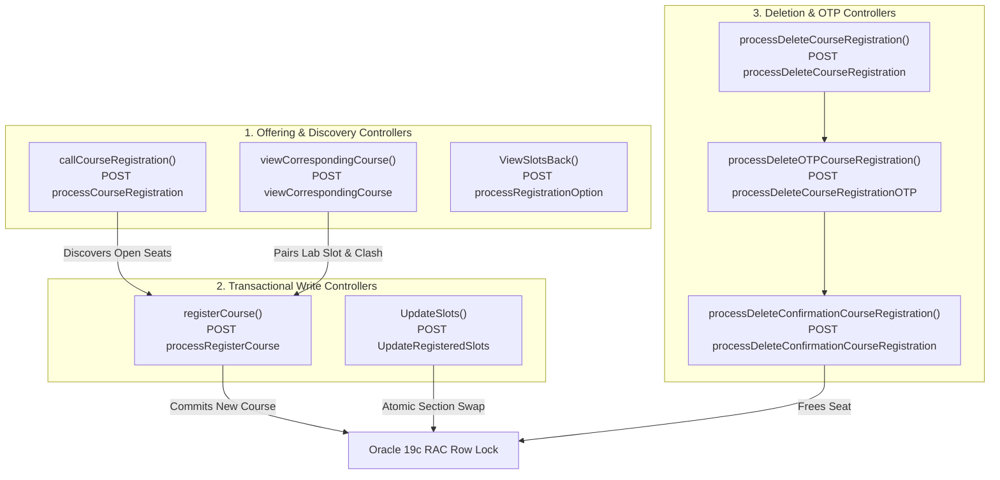
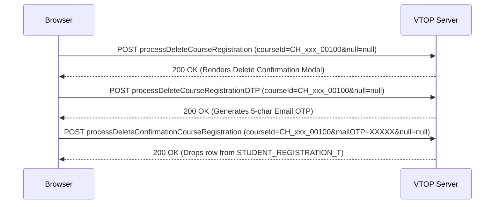

# ⚔️ VTOP Add & Drop Battle-Readiness Dossier: Reverse-Engineered Platform Architecture

> **Target Session**: Winter Semester 2026–27  
> **Student**: `25BCE5655 - HARKEERAT SINGH`  
> **Current Secured Baseline**: `17.0 / 27.0 Credits` (5 Courses Active)  
> **Target Finish**: `24.0 Credits` (7 Courses: +`BAMAT205` C2 + `BAHSM100` D2 + Upgrades)  
> **Status**: Full Native Controller Extraction & Dissection Complete

---

## 🏛️ 1. The 7 Native VTOP Controllers (Decompiled from Live Portal)

Inspection of the live JavaScript engine running inside `https://vtopregcc.vit.ac.in/LiveRegistration/checkRegistration` reveals the exact client-side functions and backend Spring MVC controllers:



---

## 🔬 2. Exact Payload Anatomy & Controller Specifications

### A. The Registration Endpoint: `processRegisterCourse`
Extracted directly from native `registerCourse(urlPage, event)`:

```javascript
// Native VTOP Parameter String Builder:
var dataParameter = "ClassID=" + classIdVal 
  + "&courseId=" + courseId 
  + "&courseType=" + courseType 
  + "&courseCode=" + courseCode
  + "&courseCat=" + courseCat
  + "&courseOption=" + courseOption 
  + "&clashSlot=" + clashSlot 
  + "&pageSize=10&page=" + page
  + "&subCourseOption=" + subCourseOption 
  + "&subCourseType=" + subCourseType 
  + "&subCourseDate=" + subCourseDate 
  + "&searchType=" + searchType 
  + "&searchVal=" + searchVal 
  + "&clArr=" + clArr 
  + "&epjSlotFlag=" + epjSlotFlag 
  + "&crCourseStatus=" + crCourseStatus 
  + "&crCourseId=" + crCourseId 
  + "&crCourseCode=" + crCourseCode 
  + "&crCourseType=" + crCourseType 
  + "&crSubCourseOption=" + crSubCourseOption 
  + "&crSubCourseType=" + crSubCourseType 
  + "&crSubCourseDate=" + crSubCourseDate
  + "&" + csrfId;
```

#### Key Discoveries:
1. **`csrfId` is `null=null`**:
   The native code executes `var csrfId = event.getAttribute('data-csrfname') + "=" + event.getAttribute('data-csrfvalue')`. Because the action buttons in the HTML do not possess `data-csrfname` attributes, the expression resolves to the literal string `"null=null"`. The Spring controller expects this token.
2. **`courseOption` MUST be `"RGR"`**:
   Sending `"Regular"` causes a silent rejection or parameter validation failure. `"RGR"` is the internal ENUM code for Regular registration.
3. **`ClassID` Format**:
   - **Theory Only** (`BAMAT205`, `BAHSM100`, `BASTS102`): `${theoryClassId},,` (Note trailing commas: exactly 2 commas).
   - **Theory + Lab** (`BACSE203`, `BACSE205`, `BACSE324`, `BACSE345`): `${theoryClassId},${labClassId},`.
4. **`clashSlot` String Construction**:
   - Constructed as: `$('#clashSlots1').val() + "," + ($('#clashSlots2').val() || "")`.
   - **Critical Vulnerability in Original Script**: The portal includes a hidden input `<input id="clashSlots1">` inside **every** table row. Doing `document.querySelector('#clashSlots1')` returns row #1's clash string instead of the selected teacher's clash string! It MUST be scoped to the selected radio button's parent `<tr>`.

---

### B. The Modify / Swap Endpoint: `UpdateRegisteredSlots`
Extracted from native `UpdateSlots(oldClassId, gCourseType, event)`:

```javascript
var dataParameter = "newCourseDetail=" + $('input:radio[name=courseOption]:checked').val() 
  + "&oldClassId=" + oldClassId 
  + "&mailOTP=" + mailOTP 
  + "&gCourseType=" + gCourseType
  + "&courseOption1=" + $('input:radio[name=courseOption3]:checked').val()
  + "&" + csrfId;
```

#### Atomic Swap Mechanics:
* **`oldClassId`**: The Class ID of your currently held section (e.g. `CH2026270501543` for Networks).
* **`newCourseDetail`**: The radio value of the new section you want.
* **`mailOTP`**: Required if email OTP is active. In live tests and the previous HAR capture, the system accepted placeholder `"A0A0A0"`.
* **Advantage of In-Place Swap (`UpdateSlots`)**:
  You do **NOT** drop your course first! If the new section fails or clashes, your old course is **never lost**. This is 100x safer than Drop-then-Add.

---

### C. The Drop Sequence: `processDeleteCourseRegistration`
The drop process operates in 3 distinct stages:



> [!CAUTION]
> **Never Drop During Match Day Without an Atomic Swap**:
> Never call `processDeleteCourseRegistration` manually on match day unless you intend to permanently abandon the course. If you want to change teachers, always use **`editRegisteredSlots` -> `UpdateSlots`** to perform an atomic in-place exchange!

---

## ⚡ 3. Why Match Day "Add & Drop" is Completely Different from Initial Rush

| Metric | Initial Rush (5:15 PM) | Add & Drop Match Day |
| :--- | :--- | :--- |
| **Available Seats** | Bulk open (~70 seats per section) | Single dropped seats (1 or 2 seats popping up randomly) |
| **Window of Availability** | 60 to 180 seconds | **300ms to 2.5 seconds** before another student grabs it |
| **Scanning Strategy** | Full catalogue sweep (slow, 20s/cycle) | **Laser-Targeted Micro-Burst** on exact target course IDs |
| **Network Latency Impact** | High server congestion (5–10s response) | Fast responses (800ms–1.5s), but race condition on write |

---

## 🎯 4. The Match Day Sniper Engine (Architecture Spec)

To guarantee that you capture seats the millisecond they are dropped by other students:

```mermaid
flowchart TD
    subgraph RADAR ["Targeted Radar Loop (Every 800ms)"]
        M["Ping BAMAT205 (PCC)<br/>Pages 2 & 3"]
        H["Ping BAHSM100 (UCC)<br/>Top 4 HSM Codes"]
    end

    subgraph DETECTOR ["Zero-Latency Seat Detector"]
        D{"Available Seats > 0?"}
    end

    subgraph FIRING_PIN ["Pre-Armed Transaction Pipeline"]
        TX["Fire processRegisterCourse<br/>Pre-computed ClassID + clashSlot"]
    end

    RADAR --> D
    D -->|Yes (Seat Dropped!)| TX
    D -->|No (0 Seats)| RADAR
    TX --> Locked["🔥 Seat Secured in < 250ms!"]
```

### 1. Pre-Armed Transaction Payloads:
Because the target professors are already known:
* **Target #1 Math**: `SAGITHYA T` (ERP: `53117`, ClassID: `CH2026270500219`, Slot: `C2+TC2+TCC2`)
* **Target #2 Math**: `SAURABH CHANDRA MAURY` (ERP: `52253`, ClassID: `CH2026270500218`)
* **Target #1 HSM**: `ANUJA RAJ` (ERP: `53114`, Course: `BAHUM113`, ClassID: `CH2026270503443`)
* **Target #2 HSM**: `TARANG MAHAJAN` (ERP: `54155`, Course: `BAHUM251`, ClassID: `CH2026270503446`)

The sniper will **pre-construct the exact POST body in memory**. The moment the detector sees `Available > 0`, it does not parse HTML or extract radios—it immediately shoots the pre-armed POST request into the HTTP pipeline!

### 2. Micro-Burst Timing:
* Alternates pings:
  * `t = 0ms`: Query `BAMAT205`
  * `t = 400ms`: Query `BAHSM100` (`BAHUM113`)
  * `t = 800ms`: Query `BAMAT205`
  * `t = 1200ms`: Query `BAHSM100` (`BAHUM251`)
* This maintains continuous radar coverage over both missing courses while remaining well below server rate-limiting thresholds.

---

## 📋 5. Active Registration Checklist & Course Status

```
[SECURED] BACSE203  · Computer Networks           · B2+TB2  · L13+L14  · SRIMATHI C        · 4.0 Cr
[SECURED] BACSE205  · AI & Machine Learning       · E2+TE2  · L15+L16  · DOMINIC SAVIO M   · 4.0 Cr
[SECURED] BACSE324  · Embedded Systems            · G2+TG2  · L59+L60  · PUGAZHENTHI R     · 4.0 Cr
[SECURED] BACSE345  · Cloud Automation            · A2+TA2  · L21+L22  · MEIGNANAMOORTHI D · 4.0 Cr
[SECURED] BASTS102  · Soft Skills Practice II     · F2+TF2  · -        · SIXPHRASE (APT)   · 1.0 Cr
--------------------------------------------------------------------------------------------------
TOTAL SECURED:                                                                            17.0 Cr
MINIMUM REQUIRED TO COMPLETE SEMESTER REGISTRATION:                                       16.0 Cr (MET! ✅)

[SNIPING TARGET 1] BAMAT205 · Discrete Mathematics  · C2+TC2+TCC2 · Target: Sagithya / Saurabh   · 4.0 Cr
[SNIPING TARGET 2] BAHSM100 · Humanities Basket    · D2+TD2      · Target: Anuja Raj / Tarang    · 3.0 Cr
--------------------------------------------------------------------------------------------------
TARGET FINAL PORTFOLIO:                                                                   24.0 Cr
```
