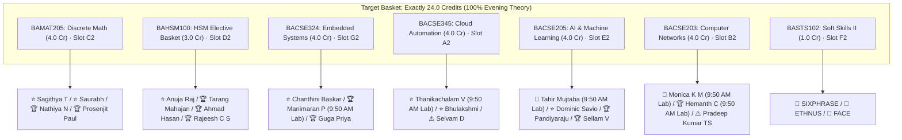
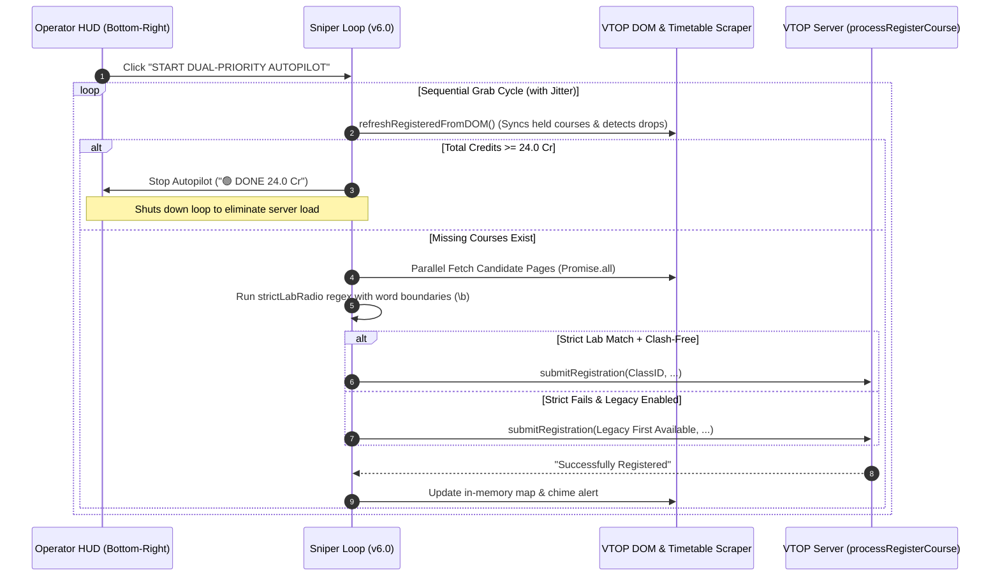

# VTOP FFCS Dual-Priority Turbo Sniper & Auto-Pilot: Operator Handoff Guide

> **Target Student:** `25BCE5655`  
> **Institution & Program:** VIT Chennai — B.Tech Computer Science and Engineering (Core)  
> **Registration Window:** Winter Semester 2026–2027  
> **Script File:** [`vtop-ffcs-autopilot.user.js`](file:///Users/harkeerat/vtop-ffcs-autopilot.user.js)  
> **Database Reference:** [`vit_courses.db`](file:///Users/harkeerat/Downloads/ffcs/vit_courses.db)  
> **Target Credits:** **24.0 Credits** (7 Courses Total)  
> **Theory Policy:** **100% Evening Theory Exclusivity** (`A2, B2, C2, D2, E2, F2, G2`)

---

## 1. Executive Summary & Core Registration Strategy

The **VTOP FFCS Dual-Priority Turbo Sniper & Auto-Pilot** is an automated client-side registration engine designed for student `25BCE5655`. It automates the entire registration process on VTOP (`https://vtopregcc.vit.ac.in/LiveRegistration/*`), prioritizing sleep preservation, high GPAs, and civil morning hours.

### Primary Directives
1. **100% Evening Theory Exclusivity**: Zero morning 1-series theory slots (`A1, B1, C1, D1, E1, F1, G1`). Every theory course is strictly in 2-series evening slots (`A2, B2, C2, D2, E2, F2, G2`).
2. **Dual-Priority Ranking Hierarchy**:
   $$\text{P2 (Good Slot + Okay Teacher)} \succ \text{P1 (Good Slot + Tier Teacher)} \succ \text{P4 (Bad Slot + Tier Teacher)} \succ \text{P5 (Damage Control)} \succ \text{P6 (Bad Slot + Okay Teacher)}$$
3. **Absolute Blacklist (P7)**: Strict exclusion of known toxic/strict faculty in early morning slots (e.g., Sivagami in `B2+L25`, Revathi in `G2+L25`).
4. **Must-Take Exceptions (Rank 0 - Top Priority)**:
   - **Monica K M (`52283`)** in `BACSE203`: Evening `B2+TB2` + `L27+L28` (Civilized Friday 09:50 AM lab).
   - **Tahir Mujtaba (`53598`)** in `BACSE205`: Evening `E2+TE2` + `L15+L16` (Civilized Wednesday 09:50 AM lab).
5. **Exact 24.0 Credit Target & Auto-Shutdown**: The engine stops automatically once all 7 courses are secured ($\ge 24.0\text{ Cr}$), removing background poll load.

---

## 2. Master Curriculum & Faculty Matrix (Audited 1:1 with `vit_courses.db`)

### Detailed Course Allocations & Lab Timing Reference

| Course Code | Official Title (from DB) | Cr | Type | Slot | Rank 1 (Top Target) | Lab Slot & Official Time | Verified Priority Fallbacks |
| :--- | :--- | :---: | :---: | :---: | :--- | :--- | :--- |
| **`BAMAT205`** | Discrete Mathematics and Linear Algebra | 4.0 | TH | **C2** | **SAGITHYA T** (`53117`) | None (Theory only) | Saurabh Chandra (`52253`) ➔ Dhivya P (`52238`) ➔ Nathiya N (`50772`) ➔ Prosenjit Paul (`52237`) |
| **`BAHSM100`** | Humanities, Social Science & Management Basket | 3.0 | TH | **D2** | **ANUJA RAJ** (`53114` - `BAHUM113`) | None (Theory only) | Binu Sahayam (`51449`) ➔ Luke Christie (`50469`) ➔ Tarang Mahajan (`54155`) ➔ Ahmad Hasan (`54798`) ➔ Rajeesh C S (`54511`) |
| **`BACSE324`** | Embedded Systems Architecture | 4.0 | ETL | **G2** | **CHANTHINI BASKAR** (`51707`) | `L15+L16` (Wed 09:50–11:30 AM) | Manimaran P (`52294`, `L27+L28` Fri 9:50) ➔ Guga Priya (`50411`, `L15+L16`) ➔ Florence (`51711`, 8 AM) |
| **`BACSE345`** | Cloud Automation Technologies | 4.0 | ETL | **A2** | **THANIKACHALAM V** (`53546`) | `L21+L22` (Thu 09:50–11:30 AM) | Bhulakshmi (`54776`, `L9+L10` 9:50) ➔ Selvam D (`53391`, 8 AM) ➔ Priyadarshini (`52200`, 8 AM) |
| **`BACSE205`** | Fundamentals of AI and Machine Learning | 4.0 | ETL | **E2** | 👑 **TAHIR MUJTABA** (`53598`) | `L15+L16` (Wed 09:50–11:30 AM) | Dominic Savio (`52610`, 9:50) ➔ Lakshmi Harika (`53077`, 9:50) ➔ Pandiyaraju (`52344`, 9:50) ➔ Sellam V (`53566`, 9:50) |
| **`BACSE203`** | Computer Networks | 4.0 | ETL | **B2** | 👑 **MONICA K M** (`52283`) | `L27+L28` (Fri 09:50–11:30 AM) | Hemanth C (`50564`, `L27+L28` 9:50) ➔ Pradeep Kumar TS (`50024`, 8 AM) ➔ Bhavadharini (`52261`, 9:50) ➔ Rukmani P (`50154`, 8 AM) |
| **`BASTS102`** | Qualitative and Quantitative Skills Practice II | 1.0 | SS | **F2** | 🥇 **SIXPHRASE(APT)** | None (Theory only) | ETHNUS (APT) ➔ FACE (APT) |
| **TOTAL** | **7 Courses** | **24.0** | — | — | — | — | **Auto-Lock Threshold: $\ge$ 24.0 Credits** |

---

## 3. Official Database Truths & Resolved Inconsistencies

1. **Tahir Mujtaba's Lab Slot (`L15+L16`) is 09:50 AM (Civilized)**:
   - Querying `slot_timings` in `vit_courses.db` confirms:
     `('L15+L16', 'MORNING', 'Wed 09:50-11:30')`
   - `L15+L16` is **Wednesday 09:50 AM to 11:30 AM**, not 8:00 AM (`L13+L14` is 8:00 AM). Tahir Mujtaba satisfies the zero-8am lab optimization.
2. **Rukmani P Lab Slot Discrepancy**:
   - `CH2026270501521` (Morning `B1+TB1`) pairs with `L29+L30` (Fri 11:40 AM).
   - `CH2026270501551` (Evening `B2+TB2`) pairs with `L25+L26` (Fri 08:00 AM).
   - In Evening `B2`, Rukmani P has an 8:00 AM lab. Only **Monica K M (`52283`)** and **Hemanth C (`50564`)** offer civilized 09:50 AM labs (`L27+L28`).
3. **Official 24.0 Credit Alignment**:
   - `curriculum_courses` confirms `BACSE203` is 4.0 Cr and `BASTS102` is 1.0 Cr ($4\times 5 + 3 + 1 = \mathbf{24.0\text{ Credits}}$).
4. **Vanish-First Grab Order**:
   - Speed order: `BAMAT205` (1) ➔ `BAHSM100` (2) ➔ `BACSE324` (3) ➔ `BACSE345` (4) ➔ `BACSE205` (5) ➔ `BACSE203` (6) ➔ `BASTS102` (7).
   - Fast-filling math and humanities electives are captured in the opening seconds, followed by core engineering and soft skills.

---

## 4. Userscript Engine Subsystems & Mechanics

The script [`/Users/harkeerat/vtop-ffcs-autopilot.user.js`](file:///Users/harkeerat/vtop-ffcs-autopilot.user.js) operates with the following components:

### Integrated Mechanics
1. **Auto-Shutdown at 24.0 Credits**:
   - Once `getRegisteredSummary().isComplete` evaluates to true ($\ge 24.0\text{ Cr}$), the engine automatically breaks the loop, sets the button to `START DUAL-PRIORITY AUTOPILOT`, and sets the status indicator to `🟢 DONE 24.0 Cr`. No unnecessary requests are sent once full.
2. **Dynamic Manual Drop Detection**:
   - `refreshRegisteredFromDOM()` scans the DOM on every cycle. If you manually drop a course in VTOP, the course is automatically cleared from `localRegisteredCourses`, and the engine immediately re-snipes a replacement on the next cycle without requiring a page reload.
3. **Rigorous Slot Clash Check (`hasClashWithExisting`)**:
   - Checks against all held theory and lab slots using the master clash matrix (`SLOT_CLASHES`), preventing invalid registration attempts.
4. **Session Expiry Watchdog (`handleSessionDead`)**:
   - If VTOP returns a session expiry or login redirect, the engine immediately pauses (`isSniperActive = false`), updates the HUD to `🔴 SESSION EXPIRED`, sounds the alert once, and halts polling until you re-login.
5. **Exact Lab Matching with Word Boundaries**:
   - Uses `new RegExp('\\b' + w + '\\b').test(text)` to match lab slots. `L1` will never match `L13` or `L15`.
6. **Safety Check**:
   - `ALLOW_AUTO_SEAT_SWAP_DROP = false` and `DRY_RUN = false` are set at the top of the script.

---

## 5. Live Registration Operator Manual

### Pre-Registration Preparation (T-15 Minutes)
1. **Extension Setup**: Ensure Tampermonkey or Violentmonkey is installed and active.
2. **Install Script**: Copy the contents of [`/Users/harkeerat/vtop-ffcs-autopilot.user.js`](file:///Users/harkeerat/vtop-ffcs-autopilot.user.js) into Tampermonkey.
3. **Confirm Safety Flags**:
   - `ALLOW_AUTO_SEAT_SWAP_DROP = false`
   - `DRY_RUN = false`
4. **Login**: Sign into VTOP (`https://vtopregcc.vit.ac.in/LiveRegistration/*`) 10–15 minutes early.
5. **Verify On-Screen HUD**:
   - Located at the **bottom-right** of the screen.
   - Initial state: `🔴 STANDBY`, `0.0 / 24.0 Cr`.
   - Click `⚙ Teacher order / fallback` to inspect or customize your rankings.

### Live-Fire Window Open (T-00:00)
1. **Engage**: Click `🎯 START DUAL-PRIORITY AUTOPILOT` in the bottom-right HUD. The button will switch to `⏹️ STOP AUTOPILOT` and the indicator will show `🟢 LIVE AUTOPILOT`.
2. **Monitor**:
   - The embedded console terminal displays real-time logs (`BLITZ CANDIDATE`, `STRICT LOCKED`, `REJECTED`).
   - A chime plays upon each successful registration.
3. **Auto-Stop**:
   - Once all 7 courses are locked (24.0 Cr), the status indicator turns green (`🟢 DONE 24.0 Cr`), the autopilot stops polling, and registration is complete.

---

## 6. Failsafe & Emergency Procedures

| Scenario | System Response | Operator Action |
| :--- | :--- | :--- |
| **All seats full for Top Teacher** | Automatically advances down the priority order to Rank 2, Rank 3, etc. | None required; let the engine cascade. |
| **Strict lab full, but theory open** | Legacy fallback engages (if checked in HUD), taking any open lab. | If you refuse an 8 AM lab under all circumstances, uncheck "Legacy fallback" in the HUD. |
| **Session Expired / Logged Out** | Autopilot immediately pauses with `🔴 SESSION EXPIRED` and sounds a warning tone. | Log back in, navigate back to Course Registration, and click `🎯 RE-LOGIN & RESTART`. |
| **Manual drop performed in VTOP** | `refreshRegisteredFromDOM()` detects the missing course on the next cycle. | No reload needed; the autopilot immediately snipes the top available teacher for that slot. |
