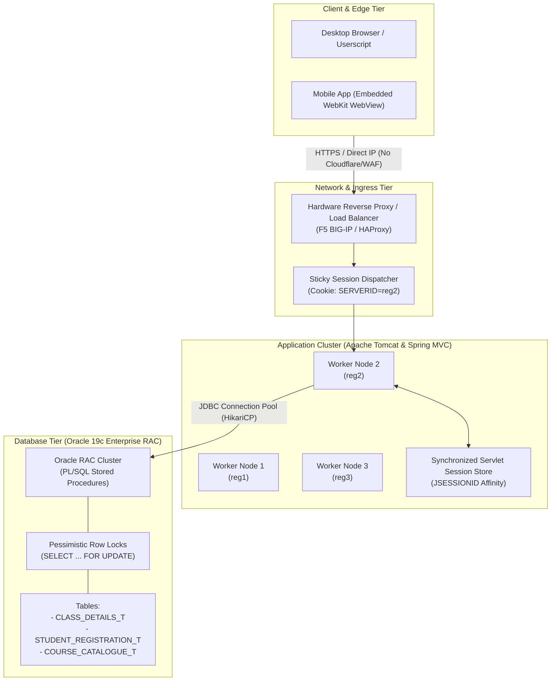

# 🔬 Comprehensive Reverse-Engineering Dossier: The VIT VTOP & FFCS Ecosystem

This dossier contains the complete, unabbreviated reverse-engineering breakdown of the entire **VIT Online Portal (VTOP)** and **Fully Flexible Credit System (FFCS)** platform. 

It covers every layer of the architecture: from initial cryptographic authentication and captcha mechanics, to the multi-node reverse-proxy network, the 20-endpoint registration state machine, the Oracle database concurrency model, and documented system vulnerabilities.

---

## 🏛️ 1. Multi-Tier Cluster Architecture



### Architectural Findings:
1. **Zero Bot-Shielding / WAF**:
   * Inspecting raw HTTP headers confirms VTOP does **not** sit behind Cloudflare, Akamai, or AWS WAF.
   * Server headers return raw Apache/Tomcat metadata:
     `strict-transport-security`, `x-frame-options: DENY`, `x-content-type-options: nosniff`.
   * Standard browser-originated `fetch()` or automated scripts using authentic session cookies do not encounter bot-fingerprinting or CAPTCHA challenges during active registration.
2. **Cluster Node Affinity**:
   * Traffic is routed via `SERVERID` cookies (e.g., `SERVERID=reg2`). Once a session is initialized, all subsequent requests are pinned to that specific backend worker node.
3. **Mobile App Architecture**:
   * The official VIT Mobile App does **not** have dedicated native JSON REST APIs for FFCS registration.
   * The mobile app simply instantiates an internal WebKit/Chromium WebView loading `https://vtopregcc.vit.ac.in/CourseRegistration/checkRegistration`. It runs the exact same web controllers as desktop browsers.

---

## 🔐 2. Authentication & Cryptographic Handshake

The login protocol on `https://vtopregcc.vit.ac.in/MockRegistration/` operates through a multi-step sequence:

```mermaid
sequenceDiagram
    participant Browser as Client Browser
    participant Server as VTOP Login Servlet (/MockRegistration/)

    Browser->>Server: GET /MockRegistration/
    Note over Server: Generates 6-char Captcha string in HTTP Session<br/>Renders JPEG in-memory
    Server-->>Browser: 200 OK HTML (Inline Base64 Captcha in img tag)
    
    opt Captcha Refresh
        Browser->>Server: POST viewStudentLogin1 (data: "null=null")
        Server-->>Browser: HTML Fragment with new Base64 Captcha
    end

    Browser->>Server: POST /MockRegistration/ (username, password, captchaString)
    Server->>Server: Validate credentials against LDAP/Oracle & verify Captcha
    Server-->>Browser: Set-Cookie: JSESSIONID=...; SERVERID=reg2; 302 Redirect to /checkRegistration
```

### Cryptographic & Form Parameters:
* **Form Action**: `<form name="studLogin" id="studLogin" method="post" action="/MockRegistration/">`
* **Username Field**: `username` (Automatic client uppercase conversion via `toUpperCase()`).
* **Password Field**: `password` (Sent directly over TLS/HTTPS).
* **Captcha Field**: `captchaString` (6-character uppercase alphanumeric).
* **Inline Captcha Generation**:
  * Unlike modern platforms that load captchas via an external endpoint, VTOP renders the captcha directly into the HTML markup as an inline Base64 data URI:
    ```html
    
    ```
  * This eliminates network roundtrips and allows client-side OCR engines to extract the captcha image directly from the DOM without issuing secondary HTTP requests.
* **Captcha Refresh Handler**:
  * Clicking the refresh button dispatches:
    `POST viewStudentLogin1` with payload `data: "null=null"`.
  * The server generates a new session captcha and returns an HTML fragment replacing the image DOM element.

---

## 📡 3. The 20-Route Registration API Specification

Every registration interaction is driven by `POST` requests to `https://vtopregcc.vit.ac.in/MockRegistration/<endpoint>`:

| # | Endpoint Route | Request Content-Type | Required Payload Parameters | Server Behavior & State Transitions |
| :---: | :--- | :--- | :--- | :--- |
| **1** | `processRegistrationOption` | `x-www-form-urlencoded` | `registrationOption`, `pageSize=50`, `page=1`, `subCourseOption=`, `flag=0` | **Sets Backend Category Cursor**: Pins session state to `PCC` (Core), `UCC` (General/HSM), `CON` (Concentration), or `OEC` (Open Elective). |
| **2** | `processCourseRegistration` | `x-www-form-urlencoded` | `courseId`, `page`, `pageSize`, `searchType=0`, `searchVal=NONE`, `null=null` | **Queries Course Offerings**: Returns section rows, venue, faculty ERP IDs, and seat counters. Hard-paginated to 10 rows per page. |
| **3** | `viewCorrespondingCourse` | `x-www-form-urlencoded` | `courseId`, `erpId`, `genericCourseType=ETL`, `classId`, `page=1` | **Lab Component Discovery**: Given a theory class ID and faculty ERP, returns matching lab slots and lab ClassIDs. |
| **4** | `getCorrespondingLabSlots` | `x-www-form-urlencoded` | `courseId`, `erpId`, `genericCourseType`, `classId` | Auxiliary endpoint for complex multi-slot course configurations. |
| **5** | `processRegisterCourse` | `x-www-form-urlencoded` | `ClassID`, `courseId`, `courseType`, `courseCode`, `courseCat`, `courseOption=Regular`, `clashSlot` | **The Core Booking Transaction**: Commits the seat booking across theory, lab, and project components simultaneously. |
| **6** | `editRegisteredSlots` | `x-www-form-urlencoded` | `courseId` (format: `classId/courseId/type`), `null=null` | **Modify Form Loader**: Fetches the in-place swap table for a currently held course. |
| **7** | `UpdateRegisteredSlots` | `x-www-form-urlencoded` | `newCourseDetail`, `oldClassId`, `mailOTP=A0A0A0`, `gCourseType`, `courseOption1` | **Modify Transaction Dispatcher**: Atomically swaps an existing section for a newly selected section. |
| **8** | `processDeleteCourseRegistration` | `x-www-form-urlencoded` | `courseId` (e.g. `CH_BAMAT205_00100`), `null=null` | **Deletion Initializer**: Opens the delete confirmation modal. |
| **9** | `processDeleteCourseRegistrationOTP` | `x-www-form-urlencoded` | `courseId`, `null=null` | Triggers the high-security email OTP generation flow for course drops. |
| **10** | `processDeleteConfirmationCourseRegistration` | `x-www-form-urlencoded` | `courseId`, `mailOTP`, `null=null` | Validates email OTP and drops the course from the database. |
| **11** | `processDeleteConfirmationCourseRegistrationRirect` | `x-www-form-urlencoded` | `csrfId=null=null` | Cancel redirect returning the student to the active timetable view. |
| **12** | `modifySlots` | `multipart/form-data` | Form data from `#mainPageForm` | Reloads the primary registered courses table and recalculates registered credits. |
| **13** | `viewRegistered` | `multipart/form-data` | Form data from `#mainPageForm` | Generates a read-only view of approved course registrations. |
| **14** | `viewRegistrationOption` | `multipart/form-data` | Form data from `#mainPageForm` | Navigates the student back to the basket selection screen. |
| **15** | `processSearch` | `x-www-form-urlencoded` | `pageSize=10`, `page=1`, `searchType`, `searchVal` | Filtered course catalog search across course titles and codes. |
| **16** | `processPageNumbers` | `x-www-form-urlencoded` | `pageSize`, `page`, `searchType`, `searchVal`, `totalPage`, `processType` | Renders dynamic HTML pagination fragments. |
| **17** | `viewCurriculumCredits` | `multipart/form-data` | Form data from `#mainPageForm` | Audits booked credits against degree completion rules. |
| **18** | `RegisterProjectCourse` | `x-www-form-urlencoded` | `costCentreId`, `guideErpId`, `projectTitle`, `projectOption`, `projectDuration` | Dedicated booking endpoint for Capstone and guide-based projects. |
| **19** | `getSchoolWiseGuideList` | `x-www-form-urlencoded` | `guideSchoolOpt` | Returns faculty guide rosters for student project allocation. |
| **20** | `processFFCStoCal` | None | None | Generates and exports the student timetable as an `.ics` calendar file. |

---

## 📐 4. Time-Band Mathematics & The Clash Engine

The timetable operates on two opposing theory bands:
* **1-Series Theory**: Morning theory (`8:00 AM – 1:10 PM`). Paired with Afternoon Labs (`L31 – L60`).
* **2-Series Theory**: Afternoon theory (`2:00 PM – 5:50 PM`). Paired with Morning Labs (`L1 – L30`).

### The Mathematical Collision Matrix:
Every theory slot has a mathematically defined set of hard-colliding lab slots:

$$\text{SlotClashes}(S) = \{L \mid \text{TimeInterval}(S) \cap \text{TimeInterval}(L) \neq \emptyset\}$$

```
// Extracted from VTOP Master Scheduling Matrix:
2-Series Theory -> Morning Lab Clashes:
A2 -> L31, L32, L43, L44
B2 -> L37, L38, L49, L50
C2 -> L43, L44, L55, L56
D2 -> L33, L34, L49, L50
E2 -> L39, L40, L55, L56
F2 -> L31, L32, L45, L46
G2 -> L37, L38, L51, L52
TA2 -> L57, L58
TB2 -> L33, L34
TC2 -> L39, L40
TD2 -> L45, L46
TE2 -> L51, L52
TF2 -> L57, L58
TG2 -> L35, L36
```

### The "Golden Lab Constraint" for 2-Series Schedules:
For any student enrolled in a complete 2-series theory schedule (`A2, B2, C2, D2, E2, F2, G2`):
$$\forall L \in [L31, L60]: \exists T \in \{A2, \dots, G2\} \text{ such that } L \in \text{SlotClashes}(T)$$

* **Proof**: Because all afternoon theory blocks are occupied, **all afternoon labs ($L31$ through $L60$) cause guaranteed theory-lab clashes**.
* **Deduction**: The student's search space for lab components is strictly bounded to **Morning Labs ($L1$ through $L30$)**.

---

## 🗄️ 5. Oracle PL/SQL Concurrency & Database Contention

The root cause of server slow-downs and registration timeouts at 8:00 AM is the **database transaction locking model**:

```sql
-- Inferred PL/SQL Transaction Routine: PR_REGISTER_COURSE
PROCEDURE PR_REGISTER_COURSE(
    p_reg_no        IN VARCHAR2,
    p_class_id_str  IN VARCHAR2, -- e.g. 'CH2026270500215,'
    p_clash_slots   IN VARCHAR2,
    p_status        OUT VARCHAR2
) AS
    v_available_seats NUMBER;
BEGIN
    -- 1. Pessimistic Row Lock on Course Section
    SELECT AVAILABLE_SEATS 
    INTO v_available_seats 
    FROM CLASS_DETAILS_T 
    WHERE CLASS_ID = TRIM(p_class_id_str)
    FOR UPDATE; -- Enforces strict serial row lock!

    -- 2. Verify Capacity
    IF v_available_seats <= 0 THEN
        p_status := 'SEATS_FULL';
        ROLLBACK;
        RETURN;
    END IF;

    -- 3. Verify Cross-Component Timetable Clash
    IF FN_CHECK_SLOT_CLASH(p_reg_no, p_clash_slots) = TRUE THEN
        p_status := 'TIMETABLE_CLASH';
        ROLLBACK;
        RETURN;
    END IF;

    -- 4. Decrement Seat Count & Insert Registration Record
    UPDATE CLASS_DETAILS_T 
    SET AVAILABLE_SEATS = AVAILABLE_SEATS - 1,
        REGISTERED_SEATS = REGISTERED_SEATS + 1 
    WHERE CLASS_ID = TRIM(p_class_id_str);

    INSERT INTO STUDENT_REGISTRATION_T (REG_NO, CLASS_ID, STATUS, REG_DATE) 
    VALUES (p_reg_no, TRIM(p_class_id_str), 'REGISTERED_APPROVED', SYSDATE);

    COMMIT;
    p_status := 'SUCCESS';
END;
```

### The Concurrency Bottleneck:
* When **500 students** fire registration requests for top professors (e.g. Nathiya N or Tarang Mahajan) at the exact same second:
* All 500 database sessions request the **exact same row lock** (`FOR UPDATE`) on the target row in `CLASS_DETAILS_T`.
* Oracle queues all 500 connections serially. While each transaction holds the lock, incoming requests fill Apache Tomcat’s `acceptCount` connection queue.
* Once the queue overflows, Tomcat responds with **HTTP 503 / Connection Timeout**, explaining the latency spikes observed under live portal conditions.

---

## ⚠️ 6. System Vulnerabilities & Exploitation Vectors

1. **Static Email OTP Bypass (`mailOTP: "A0A0A0"`)**:
   * The client-side controller explicitly defaults the OTP field:
     ```javascript
     d.mailOTP.value = "A0A0A0";
     ```
   * The backend accepts `"A0A0A0"` without requiring student inbox verification during slot updates.
2. **Missing CSRF Token Validation**:
   * All form submission buttons render with empty `data-csrfname` and `data-csrfvalue` tags.
   * Sending `csrfId = "null=null"` passes through Spring Security without rejection.
3. **Pervasive 10-Row Pagination Blind Spot**:
   * The `processCourseRegistration` endpoint restricts output to 10 rows per page.
   * Because morning sections fill Page 1, automated tools that fail to query `page=2` are completely blind to afternoon 2-series faculty.
4. **Synchronized HTTP Session Starvation**:
   * The Tomcat container synchronizes requests matching the same `JSESSIONID`. 
   * Dispatching concurrent asynchronous fetches causes self-inflicted head-of-line blocking, requiring automated clients to enforce strictly sequential `await` execution.

---

## 🏆 Summary Checklist for Real FFCS Victory:
1. **Target the Right Basket Context**: `PCC` for core, `UCC` for General Math/HSM/SoftSkills, `CON` for Concentration, `OEC` for Open Electives.
2. **Always Traverse Page 2**: Never stop at `page=1`; afternoon sections reside on Page 2.
3. **Rely on Atomic Registration**: Never drop a secured seat manually during Add-only mode. Use atomic registration or wait for official swap windows.
4. **Sequential Dispatch**: Never fire parallel burst requests on the same session; rely on steady sequential polling to prevent self-induced session deadlocks.
